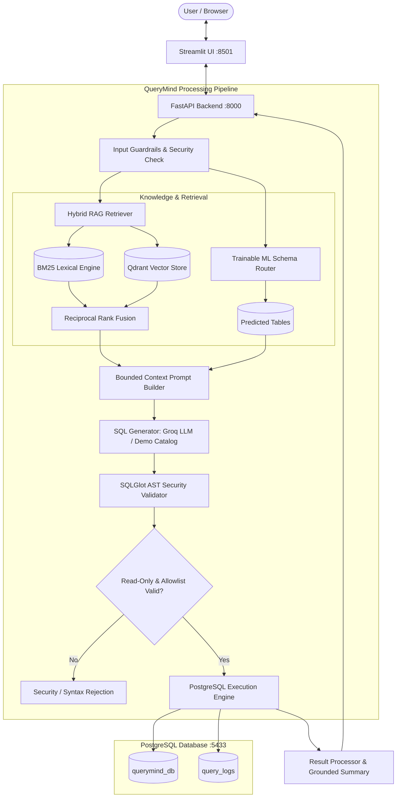

# QueryMind AI System Architecture

## Architecture Highlights
1. **Source of Truth**: Numerical data is never hallucinated or calculated by the LLM. PostgreSQL is the source of truth for all quantitative values.
2. **Trainable ML Schema Router**: Lightweight multi-label OneVsRest Logistic Regression classifier with TF-IDF features predicting relevant tables (Achieving >98% Micro F1).
3. **Hybrid Search**: Fuses dense semantic embeddings (`all-MiniLM-L6-v2`) and sparse BM25 keyword matching using Reciprocal Rank Fusion ($RRF$).
4. **Dual Execution Mode**: Supports both live generative SQL via Groq API (`llama-3.3-70b-versatile`) and offline deterministic mode with parameterized SQL templates.
5. **AST Guardrails**: SQLGlot parses every generated SQL statement before execution to guarantee zero write operations and restrict access exclusively to 10 allowed tables.
